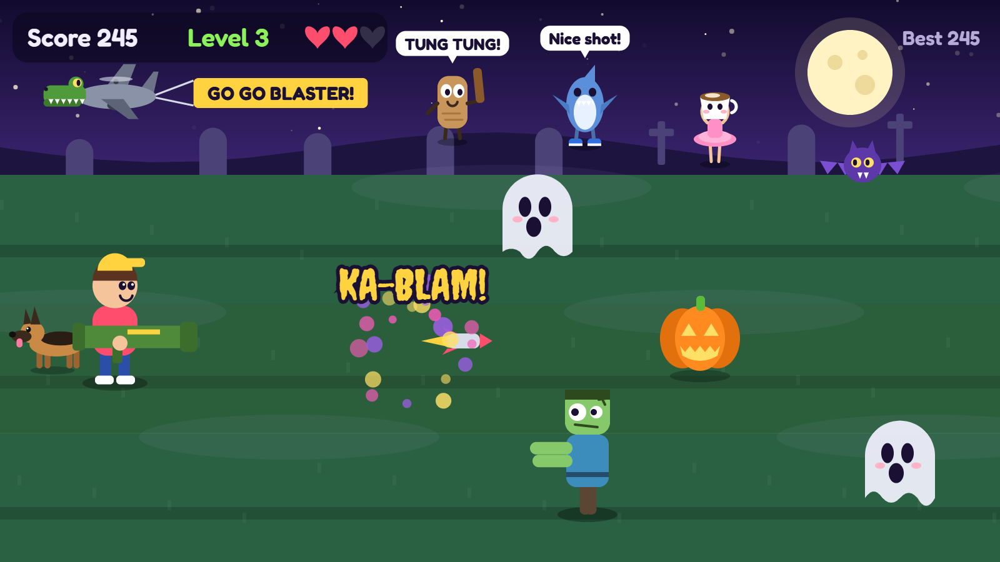

# Monster Blaster

A spooky, family-friendly arcade game that runs in the browser. Ghosts, bats, pumpkins and zombies march down three graveyard paths toward you. Hop between the paths and blast them with your bazooka before they get by!

**▶ Play it here: [Monster Blaster](https://monsterblaster-ltepepa-b7a9dsetergvcuh6.westus3-01.azurewebsites.net/)**

[](https://monsterblaster-ltepepa-b7a9dsetergvcuh6.westus3-01.azurewebsites.net/)

## How to play

Stop the monsters before they reach you. Each one that gets past costs you a heart, and the game ends when all 3 hearts are gone. Score enough points and a boss shows up to end the level. There are 7 levels: beat the final evil boss at the end of level 7 to win the game.

### Controls

| Action | Keyboard | Touch |
| --- | --- | --- |
| Move up / down | `↑` `↓` or `W` `S` | ▲ ▼ buttons, or tap above/below the kid |
| Fire | `Space`, `Enter`, `→` or `D` | **FIRE** button, or tap the kid's path |
| Pause | `P` or `Esc` | — |
| Music on / off | `M` | **Music** button |

### Monsters

| Monster | Points | Notes |
| --- | --- | --- |
| Ghost | 10 | |
| Pumpkin | 10 | |
| Bat | 15 | Fast; shows up from level 2 |
| Zombie | 25 | Takes 2 hits; shows up from level 3 |
| Boss | 100 | Ends every level, takes 10 hits, and spits slime you can dodge or shoot |
| King Rottengut | 100 | The crowned final boss at the end of level 7 |

### Extras

- **Animal rescues:** each boss you defeat sets a trapped animal free (German Shepherd, Kitten, Bunny, Piglet, Penguin, Panda Cub), and it follows you as a sidekick.
- **The ending:** defeat the final boss and every animal you rescued celebrates with you. They play together, run home to their families, share a giant feast and throw a big thank-you party for you. Then the game ends with a **Game Over: You Win!** screen. Press **Skip** or `Esc` to jump straight to it.
- **Cheer squad:** Tung Tung Tung Sahur, Tralalero Tralala and Ballerina Cappuccina cheer you on from the hill, while Bombardiro Crocodilo flies by with a banner.
- **Music and sound effects:** a spooky soundtrack and sound effects for every monster, all generated live in the browser.
- **Best score:** your high score is saved in your browser.

## Running it locally

There's nothing to install or build. Clone the repo and open `index.html` in your browser.

You can also serve the folder with any static web server, for example:

```bash
python -m http.server 8000
```

Then go to http://localhost:8000.

## Project structure

```
index.html             Page layout; loads the stylesheet and scripts
images/screenshot.png  Screenshot used in this README
css/style.css          All styling
js/
  core.js         Canvas setup, lanes, shared helpers, best score
  draw-utils.js   Basic drawing shapes (rounded boxes, hearts, speech bubbles)
  audio.js        Music and sound effects (Web Audio API)
  state.js        Game state and monster stats
  monsters.js     Spawning and drawing the regular monsters
  boss.js         Boss behaviour, slime shots and health bar
  animals.js      Rescued animals and their animations
  cutscene.js     The animated ending after the final boss
  squad.js        The cheer squad and the banner plane
  scene.js        Background, kid, rockets, score bar and per-frame drawing
  game.js         Start, pause, game over, firing and per-frame updates
  input.js        Keyboard, touch and button controls
  main.js         Title screen and the game loop (must load last)
```

The game uses plain HTML, CSS and JavaScript with the HTML5 Canvas and Web Audio APIs. There are no frameworks or dependencies. The scripts are regular `<script>` tags rather than ES modules so the game still works when the HTML file is opened directly from disk.
